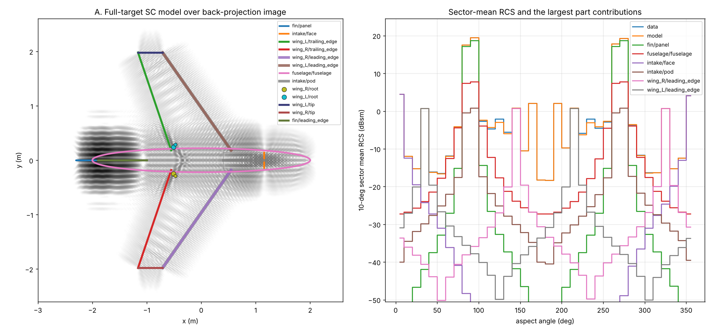
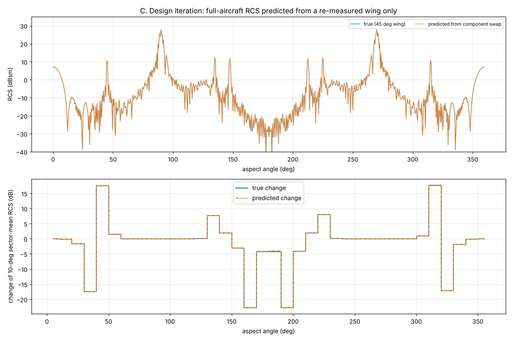

# EMSCATT: scattering-centre modelling and coherent component assembly

EMSCATT derives **part-labelled scattering-centre models** from complex RCS data (measured, simulated, or a mix), over a single plane or the full sphere. It then **assembles component models coherently** to predict the RCS of the complete object. This lets you iterate on components, measuring only the component you changed, and still track the effect on the whole-target RCS.



## What it does

1. **Extraction.** From complex S(f, r̂), it fits
   `S = Σ K_m(geometry) · a_m(r̂)`.
   * `K_m` are geometry kernels, attached to named parts taken from CAD:
     * fixed points (tips, corners, cavities);
     * sharp edges (ASC sinc);
     * **sliding** specular centres of rounded edges, cylinders and ellipsoidal hulls (GO/PO);
     * flat panels (exact PO).
   * `a_m(r̂)` are smooth complex angular amplitude patterns, one per polarisation channel.
   * Free point centres pick up whatever the parts don't explain, and are then attributed to the nearest or containing part.
   * The fitting chain:
     * greedy group-sparse selection using an FFT back-projection matched filter;
     * joint regularised least squares;
     * RELAX position refinement;
     * aspect-balanced weighting, so accuracy is uniform in dB across aspect;
     * noise-aware stopping, with the noise floor estimated automatically from range gates.
2. **Assembly.** Component models fitted in their own measurement frames are placed with rigid poses (mirroring included, so one measured wing serves as both wings). The polarisation basis is rotated, and the components are summed coherently. An **interaction model** is calibrated once against a full-target dataset and captures multi-bounce, blockage and installation effects.
3. **Design iteration.** `assembly.replace("wing_R", model=new_wing)` predicts the new full-target RCS. Sector statistics quantify the change. A coverage check flags poses that need aspects you never measured.

## Validation (generic aircraft, independent PO "truth", 45 dB SNR)

| | Result |
|---|---|
| Whole-target model, 15 part-labelled centres | 10° sector-mean error **0.26 dB rms** |
| Coherent sum of separately-fitted components | 4.4 dB rms (misses installation effects) |
| Plus interaction calibration | **0.04 dB rms**, −47 dB field error |
| Wing redesign, predicted from re-measuring the wing only | RCS change predicted to **0.03 dB rms** (true changes −23…+18 dB) |



See [docs/METHODOLOGY.md](docs/METHODOLOGY.md) for the theory, the assumptions, and the **measurement requirements**. The phase reference, calibration and coverage requirements are what make coherent assembly work on real data.

## Quick start

```bash
pip install -e .            # numpy, scipy, matplotlib
python -m pytest tests      # 20 tests
python examples/aircraft_workflow.py          # full validation demo (~2-4 min)
python examples/make_project_example.py       # CSV + JSON project example
python -m emscatt run examples/project/project.json
```

```python
import numpy as np
from emscatt import *

# 1. data: complex sqrt-RCS, exp(+jwt), phase referenced to the component origin
wing = ScatteringData.load_csv("wing.csv", freq_col="freq_ghz", freq_scale=1e9,
                               angle_cols=("az", "el"), angle_type="az_el",
                               channels={"VV": "vv"}, value_format="db_deg")
wing = wing.with_phase_reference([0.12, 0.0, 0.0])     # turntable centre in wing frame

# 2. physical parts (from CAD)
parts = [
    Part("leading_edge", [CylinderFeature(p_root, p_tip, radius=0.025),   # rounded LE (sliding)
                          EdgeFeature(p_root, p_tip)]),                    # or sharp - fit decides
    Part("trailing_edge", [EdgeFeature(te_root, te_tip)]),
    Part("root", region=(root_centre, [0.6, 0.1, 0.1])),
]

# 3. fit
res = SCFitter(wing, parts, FitConfig(alphas=(0, 0.5, 1))).fit()
print(res.report()); print(res.model.summary())

# 4. assemble, calibrate interactions, iterate
asm = Assembly()
asm.add("fuselage", fus_model)
asm.add("wing_R", res.model, Pose.from_translation([0.55, -0.18, 0]))
asm.add("wing_L", res.model, Pose.mirror([0, 1, 0], translation=[0.55, 0.18, 0]))
asm.calibrate_interactions(full_aircraft_data)
S = asm.evaluate(freqs, dir_from_az_el(np.arange(0, 360, 0.5), 0))["tt"]
new = asm.replace("wing_R", model=wing_v2).replace("wing_L", model=wing_v2)
```

## Package layout

| Module | Purpose |
|---|---|
| `conventions` | time/phase/polarisation conventions, directions, `Pose`, polarisation-basis rotation |
| `data` | `ScatteringData` blocks, CSV/NPZ I/O, phase-reference shift, noise estimate, sampling check |
| `features` | `Point/Edge/Cylinder/Ellipsoid/PlateFeature`, `Part`, part attribution |
| `basis` | smooth angular amplitude basis (planar arcs or sphere) |
| `fitting` | `SCFitter` / `FitConfig`: extraction algorithm |
| `model` | `ScatteringCentreModel`: evaluation, per-part contributions, JSON persistence |
| `assembly` | `Assembly`: coherent/incoherent sum, interaction calibration, coverage check |
| `po` | faceted physical-optics solver and mesh builders/STL loader (validation, quick predictions) |
| `imaging`, `metrics`, `plotting` | ISAR back-projection, RCS comparison metrics, figures |
| `project`, `__main__` | JSON project files and CLI |

## Background

This builds on Guo et al. (*Sliding scattering center model for extended streamlined targets*, PIER 2013) and Lu et al. (*Global scattering center representation … multiple manifold concept*, Electronics 2022), along with the attributed scattering centre and RELAX literature. The methodology note gives details.
